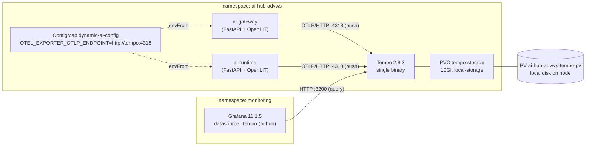

# AI Hub Tracing with Grafana Tempo: Infrastructure & Kubernetes Notes

| | |
|---|---|
| **Scope** | Infra/K8s side of distributed tracing for AI Hub (Dynamiq) |
| **Namespace** | `ai-hub-advws` (Tempo), `monitoring` (shared Grafana) |
| **Implemented** | 2026-11-03 |
| **Owner** | Pleum (DevOps/Infra) |
| **Status** | Done. Verified end-to-end with real traces from `ai-runtime`. |

---

## 1. Purpose

AI Hub runs agentic workloads. A single chat request can go through the gateway, the runtime,
an agent loop, several LLM calls (via LiteLLM → OpenRouter), tool calls, and vector-DB
retrieval. When a request is slow or fails, logs and metrics alone can't tell you *which
step* caused it.

**Distributed tracing** solves this. Every request gets a trace ID, and each step records a
*span* (name, start/end time, status, attributes) under that ID. Grafana then shows the
whole request as a waterfall.

**Grafana Tempo** is the backend that receives, stores, and serves these traces. It has no
UI of its own: traces are viewed through Grafana.

How tracing relates to the other signals:

| Signal | Answers | Backend |
|---|---|---|
| Metrics | "How many / how fast / how much, overall?" | Prometheus (shared, `monitoring`) |
| Traces | "Where did *this* request spend its time?" | **Tempo (`ai-hub-advws`)** |
| Logs | "What exactly happened at this moment?" | Loki (shared, `monitoring`) |

---

## 2. Architecture



Data flow:
1. `ai-gateway` and `ai-runtime` create spans via OpenLIT and **push** them to Tempo over
   OTLP/HTTP (`http://tempo:4318/v1/traces`).
2. Tempo writes spans to a WAL, cuts them into compressed blocks, and keeps them for 14 days.
3. Grafana (in another namespace) **queries** Tempo's API on port 3200 through cluster DNS.

---

## 3. Application side (context only, no code was changed)

Tracing is implemented in the app by `ai/app/core/otel.py` using **OpenLIT** (an
OpenTelemetry-based SDK for GenAI workloads).

| Setting | Value | Why it matters to infra |
|---|---|---|
| Activation | Only if `OTEL_EXPORTER_OTLP_ENDPOINT` is set; otherwise a no-op | Infra controls on/off via the ConfigMap |
| `application_name` | `app.title` | Becomes `service.name` in Tempo (observed: `ai-runtime`) |
| `capture_message_content` | `False` | **No prompt/completion text in spans.** Tempo has no per-tenant access control, so this keeps customer content out of the trace store. |
| `disable_metrics` | `True` | Metrics come from `app/core/metrics.py` → Prometheus, not from OpenLIT |
| Called from | `main_gateway.py`, `main_runtime.py` | **`ai-worker` does not emit traces** (no `setup_tracing()` call) |

OpenLIT auto-instruments GenAI calls (LLM, agent, vector DB). It does **not** create a span
for every HTTP request. A service therefore only appears in Tempo after it has actually
executed a run.

---

## 4. Kubernetes resources

All Tempo resources live in `ai-hub-advws`, except the PV, which is cluster-scoped.

| Kind | Name | Notes |
|---|---|---|
| ConfigMap | `tempo-config` | Tempo config file `tempo.yaml` |
| Deployment | `tempo` | 1 replica, `grafana/tempo:2.8.3`, strategy `Recreate` |
| Service | `tempo` | ClusterIP: 4317 (OTLP gRPC), 4318 (OTLP HTTP), 3200 (query API) |
| PersistentVolumeClaim | `tempo-storage` | 10Gi, RWO, `storageClassName: local-storage` |
| PersistentVolume | `ai-hub-advws-tempo-pv` | Static local PV, `Retain`, pre-bound by `claimRef` |
| ConfigMap (existing) | `dynamiq-ai-config` | Holds `OTEL_EXPORTER_OTLP_ENDPOINT: http://tempo:4318` |

### 4.1 Tempo configuration (`tempo-config`)

| Key | Value | Meaning |
|---|---|---|
| `server.http_listen_port` | `3200` | Query API, `/ready`, `/metrics` |
| `distributor.receivers.otlp` | gRPC `0.0.0.0:4317`, HTTP `0.0.0.0:4318` | Explicit `0.0.0.0` is required: since Tempo 2.7 the OTLP receiver binds to `localhost` by default, which would be unreachable from other pods |
| `ingester.trace_idle_period` | `10s` | A trace is flushed from memory 10s after its last span |
| `compactor.compaction.block_retention` | `336h` | **14-day retention** |
| `storage.trace.backend` | `local` | Blocks at `/var/tempo/traces`, WAL at `/var/tempo/wal` |
| `usage_report.reporting_enabled` | `false` | No anonymous usage stats sent to Grafana Labs from production |

### 4.2 Deployment `tempo`: design decisions

| Item | Value | Rationale |
|---|---|---|
| `strategy.type` | `Recreate` | The PVC is RWO on a local disk. With the default RollingUpdate, the new pod could start before the old one releases the volume and hang on Multi-Attach. |
| `securityContext.fsGroup` | `10001` | The Tempo image runs as uid/gid 10001. Without this, the mounted volume is root-owned and Tempo cannot write. |
| `resources.requests` | `cpu: 100m`, `memory: 256Mi` | Ensures scheduling with a realistic baseline |
| `resources.limits` | `memory: 1Gi` (no CPU limit) | Caps memory so the ingester can't starve neighbours. No CPU limit, to avoid CFS throttling. |
| `GOMEMLIMIT` | `900MiB` | Tempo is written in Go. This soft target makes the GC reclaim memory before hitting the 1Gi limit, so OOMKills are less likely. |
| `readinessProbe` | `GET /ready :3200`, initial delay 15s | Tempo returns 503 for about 15s at startup (ingester ring warm-up) |
| `livenessProbe` | `tcpSocket :3200`, initial delay 30s | Deliberately **not** `/ready`: a temporary 503 must not trigger restart loops |

### 4.3 Environment wiring

`ai-gateway`, `ai-runtime` and `ai-worker` load `dynamiq-ai-config` via `envFrom`. The value
`http://tempo:4318` uses the short service name, which resolves because the apps and Tempo
are in the same namespace.

> **Important:** `envFrom` is read only at container start, and `dynamiq-ai-config` is a plain
> ConfigMap (no hash suffix). After changing it, the apps must be restarted:
> `kubectl -n ai-hub-advws rollout restart deploy/ai-gateway deploy/ai-runtime`

---

## 5. Storage

### 5.1 Why a static PV is needed

This cluster has **no dynamic provisioner**. All StorageClasses use
`kubernetes.io/no-provisioner`:

```
NAME                  PROVISIONER                    VOLUMEBINDINGMODE
local-storage         kubernetes.io/no-provisioner   WaitForFirstConsumer
loki-storage          kubernetes.io/no-provisioner   Immediate
uptime-kuma-storage   kubernetes.io/no-provisioner   WaitForFirstConsumer
```

A PVC on its own would stay `Pending` forever, so the PV was created manually. It follows the
same pattern as the existing `pv-loki-new`.

### 5.2 How the PV and PVC are bound

| Mechanism | Where | Effect |
|---|---|---|
| `claimRef: ai-hub-advws/tempo-storage` | PV | Reserves the PV for exactly this PVC. The binder always prefers a PV pre-bound to the claim. |
| `storageClassName: local-storage` | PV + PVC | Classes must match for binding |
| `WaitForFirstConsumer` | StorageClass | Binding happens when the pod is scheduled, so the scheduler respects the PV's node affinity |
| `nodeAffinity` (hostname) | PV | Pins the volume, and therefore the Tempo pod, to one node |
| No `volumeName` | PVC | Intentional. It keeps the infra-owned PV name out of the app manifests, and PVC spec is immutable after creation. After binding, Kubernetes fills `spec.volumeName` automatically. |

Node preparation (done before applying the PV):

```bash
sudo mkdir -p /mnt/tempo-ai-hub && sudo chown 10001:10001 /mnt/tempo-ai-hub
```

A local PV does not create its path. If the directory is missing, the pod stays in
`ContainerCreating` with "path does not exist".

### 5.3 What Tempo stores on disk

| Path | Content | Lifecycle |
|---|---|---|
| `/var/tempo/wal` | Write-ahead log: incoming spans appended immediately | Small, constantly rotated |
| `/var/tempo/traces` | Blocks in **Apache Parquet** (columnar, compressed) plus bloom filters and indexes | Cut about every 30 min. The compactor merges blocks and deletes those older than 14 days. |

During compaction, new blocks are written *before* old ones are deleted, so keep about 20–30%
free space.

### 5.4 Sizing

Estimate = requests/day × spans/request × bytes/span × 14 days.
Assumptions: about 30 spans per agentic run, and about 0.5 KB per span compressed. Both are
estimates and depend on attributes.

| Runs/day | Per day | 14 days | Fits 10Gi? |
|---|---|---|---|
| 1,000 | ~15 MB | ~0.2 GB | Easily |
| 10,000 | ~150 MB | ~2.1 GB | Yes |
| 30,000 | ~450 MB | ~6.3 GB | Tight, once compaction headroom is included |
| 50,000+ | ~750 MB | ~10.5 GB | No. Reduce retention or grow the disk. |

> **Caveat: a local PV has no quota.** `capacity: 10Gi` is only used for PV/PVC matching.
> Tempo can write until the node's filesystem is full. If `/mnt/tempo-ai-hub` shares the root
> filesystem, a full disk causes node `DiskPressure` and evicts other pods. Mitigations:
> - a dedicated partition or LV for the path (ideal), or
> - a node disk-usage alert in Prometheus (minimum).

---

## 6. Grafana integration (shared Grafana in `monitoring`)

No new Grafana was deployed. Tempo was added as a datasource to the existing one.

| Item | Value |
|---|---|
| Grafana | v11.1.5, Helm chart `grafana-8.5.0`, Service `ClusterIP:80`, no Ingress |
| Datasource name | `Tempo (ai-hub)` (not default) |
| URL | `http://tempo.ai-hub-advws.svc.cluster.local:3200` |

The FQDN is required because Grafana is in a different namespace. The short name `tempo`
only resolves inside `ai-hub-advws`.

**Why the datasource was added through the UI instead of provisioning:**
- The Grafana deployment has **no provisioning sidecar**. `/etc/grafana/provisioning/datasources`
  is empty, and no ConfigMaps carry the `grafana_datasource` label.
- All existing datasources (Prometheus, Loki) were added through the UI, so this matches.
- Grafana's SQLite DB lives on PVC `grafana-pvc`, so UI changes survive restarts.

> **Warning: Helm drift on Grafana.** The release has `USER-SUPPLIED VALUES: null`, yet the live
> Deployment has a PVC mount (`grafana-storage` → `grafana-pvc`), `TZ=Asia/Bangkok`, and a custom
> `grafana.ini`. All of these were added outside Helm. Running `helm upgrade grafana` without
> reconstructing these values would revert them, including the persistence mount. Back up first:
> `kubectl -n monitoring get deploy grafana -o yaml > grafana-deploy-backup.yaml`.

---

## 7. Network & security

| Aspect | State |
|---|---|
| NetworkPolicy | `ai-hub-advws` has only `fake-sso-same-namespace-only` (selector `app=fake-sso`), so nothing blocks app → Tempo or Grafana → Tempo. `monitoring` has none. |
| Exposure | Tempo is **ClusterIP only**, not reachable from outside the cluster |
| Auth | Tempo's API (3200) and OTLP ports have **no authentication**. Any pod in the cluster can push or query traces. |
| Data sensitivity | Spans hold timing, model names, token counts and cost, but **no message content** (`capture_message_content=False`) |
| Viewer access | Anyone with access to the shared Grafana can view AI Hub traces |

---

## 8. Deployment runbook

Apply individual files only. **Do not run `kubectl apply -k deploy/k8s/base`** against a live
namespace that already has real Secrets in it: the kustomization used to include
`secrets.example.yaml` (now removed - see that file's own header and kustomization.yaml's
comment), which holds literal `"TODO-generate"` placeholder values and would have overwritten
the real Secrets.

```bash
# 0) Confirm there is no dynamic provisioner (all no-provisioner -> a static PV is needed)
kubectl get sc

# 1) Prepare the directory on the target node
sudo mkdir -p /mnt/tempo-ai-hub && sudo chown 10001:10001 /mnt/tempo-ai-hub

# 2) Static PV (node name filled in)
kubectl apply -f tempo-pv.yaml
kubectl get pv ai-hub-advws-tempo-pv            # Available, claim ai-hub-advws/tempo-storage

# 3) Tempo + app config
kubectl apply -f tempo-deployment.yaml -f ai-config.yaml --dry-run=server
kubectl apply -f tempo-deployment.yaml -f ai-config.yaml
kubectl -n ai-hub-advws rollout status deploy/tempo
kubectl -n ai-hub-advws get pvc tempo-storage   # Bound -> ai-hub-advws-tempo-pv

# 4) Restart apps so they pick up OTEL_EXPORTER_OTLP_ENDPOINT
kubectl -n ai-hub-advws rollout restart deploy/ai-gateway deploy/ai-runtime

# 5) Grafana UI: Connections > Data sources > Tempo
#    URL http://tempo.ai-hub-advws.svc.cluster.local:3200 > Save & test
```

---

## 9. Verification (performed 2026-11-03)

| Check | Command / method | Result |
|---|---|---|
| Tempo healthy | `curl :3200/ready` | `ready` |
| PVC bound | `kubectl -n ai-hub-advws get pvc tempo-storage` | `Bound` → `ai-hub-advws-tempo-pv` |
| Grafana → Tempo connectivity | `kubectl -n monitoring exec deploy/grafana -c grafana -- curl -s http://tempo.ai-hub-advws.svc.cluster.local:3200/ready` | `ready` |
| Apps have the endpoint | `kubectl -n ai-hub-advws exec deploy/<app> -- printenv OTEL_EXPORTER_OTLP_ENDPOINT` | `http://tempo:4318` (both) |
| Traces received from the apps | `curl :3200/api/search/tag/service.name/values` | `{"tagValues":["ai-runtime"]}` |
| Cross-check with metrics | `sum by (service)(runs_total{namespace="ai-hub-advws"})` | Runs only on `ai-runtime` |

`ai-gateway` has no traces yet because it has executed no runs. Test chats were served by
`ai-runtime`, and the metric confirms this. Gateway traces will appear automatically once
runs go through the gateway API.

Helper scripts produced during this work:
- `tempo-smoke-test.sh`: sends a synthetic OTLP span, reads it back by trace ID, runs a
  TraceQL search, and lists `service.name` values.
- `check-observability-readiness.sh`: read-only end-to-end readiness check (apps,
  Prometheus, Tempo, Grafana).

> Tip: when backgrounding `kubectl port-forward`, add `sleep 2` before the next command, and
> stop it with `kill $!`.

---

## 10. Operations (day 2)

| Task | How |
|---|---|
| Check disk usage | `kubectl -n ai-hub-advws exec deploy/tempo -- du -sh /var/tempo/wal /var/tempo/traces` |
| Logs | `kubectl -n ai-hub-advws logs deploy/tempo --tail=100` |
| Change retention | Edit `block_retention` in `tempo-config`, then `rollout restart deploy/tempo` |
| Upgrade Tempo | Bump the image tag (pin an exact version, not `latest`). `Recreate` causes a short gap in ingestion. |
| Find slow requests | Grafana → Explore → `Tempo (ai-hub)` → Search, or TraceQL, e.g. `{resource.service.name="ai-runtime" && duration > 10s}` |

**Failure modes:**

| Event | Impact |
|---|---|
| Tempo down / restarting | Spans sent during the outage are lost. **Chat traffic is unaffected**: the OTLP exporter only logs export errors. |
| Disk full | New traces dropped. If the disk is shared with root, see the DiskPressure caveat in §5.4. |
| PV node down | Tempo cannot reschedule elsewhere (local PV) until the node returns. This is accepted for a non-HA, 14-day trace store. |
| Data loss | Traces are not backed up. This is acceptable: they are diagnostic data, and the authoritative per-run record is `logs.runs` in the database. |

---

## 11. Known limitations & follow-ups

- [ ] **Measure real usage** after 1–2 days of traffic (`du`), and re-evaluate the 10Gi PV and 14-day retention.
- [ ] **Disk alert** for the node hosting `/mnt/tempo-ai-hub` (or move it to a dedicated partition).
- [ ] **`ai-worker` has no tracing.** This needs an app change by Dev (`setup_tracing()` in the worker).
- [ ] Single replica, no HA. This is intentional, and the same scope as postgres/redis in this namespace.
- [ ] No auth on the Tempo API. Consider a NetworkPolicy allowing only `ai-hub-advws` pods (OTLP) and `monitoring/grafana` (3200).
- [ ] Optional: trace-to-logs linking in Grafana. This requires app logs in Loki with `trace_id`.
- [ ] Dev access to the shared Grafana (internal Ingress via the NGINX L7 proxy, plus Grafana accounts).

---

## Appendix A: `tempo-deployment.yaml` (as applied)

See [deploy/k8s/base/tempo-deployment.yaml](base/tempo-deployment.yaml) in this repo - kept
in sync with what's actually applied in-cluster, rather than duplicated here.

## Appendix B: `tempo-pv.yaml` (template; node name filled in at apply time)

```yaml
# Static local PV for ai-hub-advws/tempo-storage.
# Cluster-scoped and node-specific, so kept out of the app repo's kustomize base.
# Same pattern as pv-loki-new (local-storage, Retain, pre-bound via claimRef).
#
# Before applying, on the target node:
#   sudo mkdir -p /mnt/tempo-ai-hub && sudo chown 10001:10001 /mnt/tempo-ai-hub
apiVersion: v1
kind: PersistentVolume
metadata:
  name: ai-hub-advws-tempo-pv
spec:
  capacity:
    storage: 10Gi
  accessModes:
    - ReadWriteOnce
  volumeMode: Filesystem
  persistentVolumeReclaimPolicy: Retain
  storageClassName: local-storage
  claimRef:
    namespace: ai-hub-advws
    name: tempo-storage
  local:
    path: /mnt/tempo-ai-hub
  nodeAffinity:
    required:
      nodeSelectorTerms:
        - matchExpressions:
            - key: kubernetes.io/hostname
              operator: In
              values:
                - <NODE_NAME>   # replace with the chosen worker node
```

> Confirm the live values with `kubectl get pv ai-hub-advws-tempo-pv -o yaml`.
